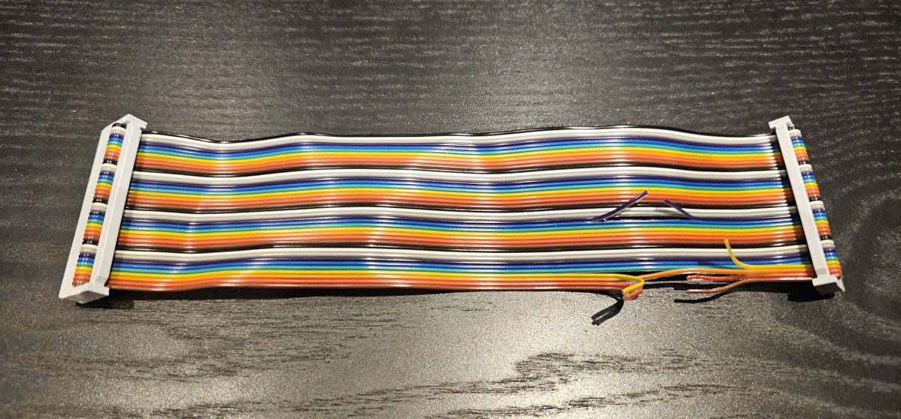
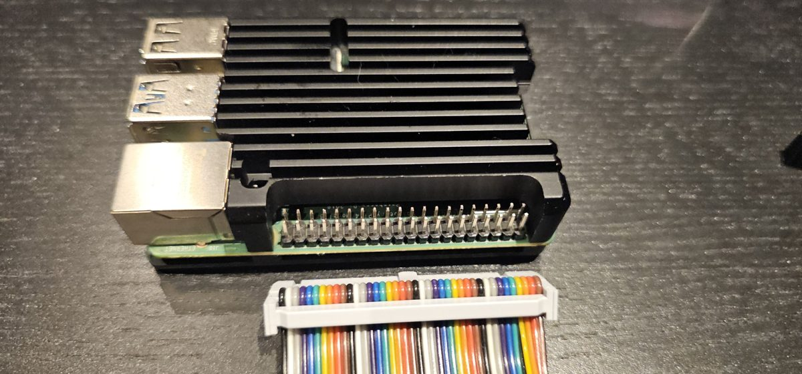
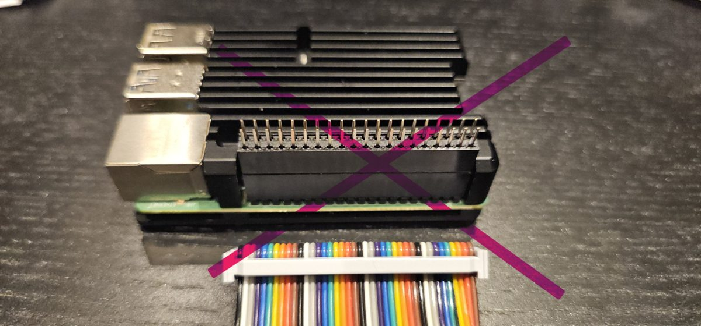

# Golem: inicio rápido

*De la caja al primer sonido en unos 20 minutos. La guía completa es
[guia.md](guia.md). English version: [quickstart.md](quickstart.md).*

El Golem es una Raspberry Pi que toca la música MIDI del ZX Spectrum Next: un
MT-32, un sintetizador General MIDI (FluidSynth) y el chip FM de una Sound
Blaster (OPL3). El Next le manda el MIDI por un cable y recibe el sonido por
el mismo cable, así que sale por el HDMI del Next como siempre.

> **Un montaje de pruebas, bajo tu responsabilidad.** El Golem está en
> desarrollo y este montaje es para probarlo. El cable va en un conector
> interior del Next, así que el Next tiene que estar abierto: lo ideal es una
> placa sin caja o una máquina de pruebas, como un N-Go, no el Next que más
> aprecies. Sigue los pasos con cuidado. Lo usas por tu cuenta y riesgo: el
> software y estas instrucciones no tienen garantía, y los autores no se
> hacen responsables de ningún daño.

## Qué necesitas

- Un ZX Spectrum Next con NextZXOS.
- Una Raspberry Pi 4 (basta con 1 GB) o Pi 3, **desnuda, sin carcasa** (mira
  la Parte 1, paso 4), con **su propia fuente de alimentación** (para una
  Pi 4, la oficial USB-C de 5,1 V y 3 A). El Next no la alimenta.
- Una tarjeta microSD para la Pi (cualquier tamaño, FAT32).
- Un **cable plano de 40 hilos** con conector IDC hembra en los dos extremos
  (2×20, paso 2,54 mm), lo más corto que puedas, y unos alicates de corte
  pequeños.
- Opcional: las ROMs del MT-32 o del CM-32L, para el sonido MT-32. No se
  incluyen: las pones tú. Sin ellas funcionan igual FluidSynth (General MIDI,
  con un SoundFont gratuito, mira la Parte 2) y el OPL3.

## Parte 1. Hardware: el cable

De momento el enlace es un cable plano normal con cuatro hilos cortados. Se
está diseñando un adaptador propio.

> **Todo apagado y desenchufado mientras trabajas.** Nunca conectes ni
> desconectes el cable con el Next o la Pi encendidos.

1. **Localiza el hilo 1.** Está en un borde del cable: en un cable gris, el
   de la raya de color; en un cable de colores, el marrón del borde (los
   colores se repiten: marrón, rojo, naranja, amarillo, verde, azul, violeta,
   gris, blanco, negro). Los conectores marcan además la patilla 1 con un
   triangulito. Los hilos van numerados en orden a lo ancho del cable: el
   hilo *n* va a la patilla *n* en los dos extremos.
2. **Corta los hilos 1, 2, 4 y 17** (3,3 V y 5 V; en un cable de colores:
   marrón, rojo, amarillo y el violeta del segundo grupo), cerca de uno de
   los conectores. El Next y la Pi tienen fuentes separadas y estas líneas no deben
   unirlas; solo se comparte la masa. Separa los extremos cortados, o cúbrelos
   con cinta, para que no se toquen. Si tienes polímetro, comprueba que las
   patillas 1, 2, 4 y 17 ya no conectan de un extremo al otro.

   

3. **En el Next:** el cable va al conector **Accelerator**, el de 2×20 donde
   iría una Raspberry Pi Zero (no el J15). Quita la Pi Zero si hay una puesta.
   El hilo 1 del cable en la patilla 1 del conector.

4. **En la Pi:** el otro extremo en el conector GPIO de 40 patillas de la Pi,
   con el hilo 1 en la patilla 1. La patilla 1 está en el extremo del
   conector más alejado de los puertos USB.

   **Usa la Pi desnuda.** Muchas carcasas, como la de disipador de la foto,
   dejan las patillas demasiado cortas o encajonadas para el conector del
   cable, y no entra. Con un elevador (un alargador del conector) entraría,
   pero no lo recomendamos: es frágil y sus patillas largas se doblan con
   facilidad. Para probar, saca la Pi de su carcasa.

   

   

5. Revisa otra vez los dos extremos: el hilo 1 en la patilla 1 en los dos,
   sin ninguna patilla fuera.

## Parte 2. Software

### La tarjeta de la Pi

1. Descarga la última versión del firmware Golem, `mt32-pi-golem-x.y.z.zip`:
   <https://github.com/malandante/mt32-pi/releases/latest>.
2. Descomprímelo en una microSD vacía formateada en FAT32, en la raíz. Nada
   más: la tarjeta no se graba como imagen, así que no hacen falta Raspberry
   Pi Imager, balenaEtcher ni ningún fichero de imagen.
3. Opcional: copia las ROMs del MT-32 o del CM-32L en `roms/`. Cada
   sintetizador necesita dos: la **ROM de control** (su programa) y la **ROM
   PCM** (sus sonidos muestreados). Los nombres de los ficheros dan igual.
   Tamaños de las ROMs completas:

   | ROM | Tamaño |
   | --- | --- |
   | Control del MT-32, versiones 1.xx («old») | 64 KB |
   | Control del MT-32, versiones 2.xx («new») | 128 KB |
   | Control del CM-32L | 64 KB |
   | PCM del MT-32 | 512 KB |
   | PCM del CM-32L | 1 MB |

   Dos cosas a vigilar:

   - **Solo ROMs completas.** En el sintetizador real algunas ROMs están
     repartidas en dos chips, y muchas colecciones las guardan además como
     dos medios ficheros, llamados por ejemplo `…_a` y `…_b`, o `…_h` y
     `…_l`, cada uno de la mitad del tamaño de la tabla. El Golem no admite
     mitades: copia solo el fichero completo.
   - **Una ROM de control por juego.** El Golem tiene tres juegos: MT-32
     «old», MT-32 «new» y CM-32L. Copia como mucho una ROM de control de cada
     uno (por ejemplo `mt32_ctrl_1_07.rom`, `mt32_ctrl_2_07.rom` y
     `cm32l_ctrl_1_02.rom`), con las ROMs PCM. Con varias del mismo juego
     puede elegir una que no querías. No copies una colección de ROMs
     entera.

   Otros SoundFonts van en `soundfonts/`.
4. Abre `mt32-pi.cfg` en la tarjeta con un editor de texto, busca la línea
   `output_device = pwm` y cámbiala por `output_device = i2s`. Sin eso, la
   Pi manda su sonido a su propia salida de auriculares en lugar de al Next.
5. Para General MIDI (FluidSynth), descarga el SoundFont gratuito
   GeneralUser GS de <https://www.schristiancollins.com/generaluser.php> y
   copia su fichero `.sf2` en `soundfonts/`.
6. Pon la tarjeta en la Pi.

La próxima versión del firmware vendrá con los pasos 4 y 5 ya hechos.

Sin ROMs del MT-32 el Golem arranca con FluidSynth; sin SoundFont tampoco, con
el OPL3. No hay que cambiar nada: `.golem status` dice qué motor está activo.

### La tarjeta del Next

1. Descarga la última versión de golem-next, `golem-next-x.y.z.zip`:
   <https://github.com/malandante/golem-next/releases/latest>.
2. Copia sus carpetas `nextzxos`, `dot`, `docs` y `midi` en la raíz de la
   tarjeta del Next, mezclándolas con las que ya hay.
3. Instala el driver cada vez que arranca el Next: carga el programa de inicio
   (`LOAD "c:/nextzxos/autoexec.bas"`, o empieza uno nuevo si no existe),
   añade estas líneas y guárdalo con `SAVE "c:/nextzxos/autoexec.bas"`:

   ```
   10 .install "c:/nextzxos/GOLEM.DRV"
   20 .golem output golem
   ```

   La segunda línea activa desde el arranque el enlace de sonido del Next con
   la Pi (su puerto I²S): el sonido de la Pi entra en el Next por el cable
   del Golem. Al encender, el Next tiene ese enlace apagado hasta que una
   orden `.golem` lo usa, así que sin esta línea un teclado MIDI conectado a
   la Pi no suena hasta entonces.

### Primer sonido

1. Enciende la Pi y después el Next. Dale a la Pi unos 10 segundos.
2. En el Next:

   ```
   .golem status
   ```

   Contesta con una línea que empieza por `Golem: engine`. Si dice
   «no answer», mira más abajo.
3. Una nota de prueba (nota 60, velocidad 100, 2 segundos) en el motor que
   está siempre, el OPL3, y en General MIDI (FluidSynth, si copiaste el
   SoundFont):

   ```
   .opl3 note 60 100 2
   .gm note 60 100 2
   ```

   Si pusiste las ROMs del MT-32 en la tarjeta de la Pi, prueba también ese
   motor:

   ```
   .mt32 note 60 100 2
   ```

   Sin ROMs contesta con un error: el MT-32 no está disponible, y lo demás
   funciona igual.
4. Toca un fichero MIDI tuyo, eligiendo el motor: `.mt32 play cancion.mid`
   para música de MT-32 (la mayoría de los juegos de PC de 1988-1992),
   `.gm play cancion.mid` o `.opl3 play cancion.mid` para General MIDI.
   SPACE lo para.
5. Ayuda en el Next: `.guide golem`.

## Si no funciona

**«Golem: GOLEM.DRV missing or incompat.»** El driver no está instalado, así
que las órdenes no pueden hablar con la Pi. Ejecuta a mano
`.install "c:/nextzxos/GOLEM.DRV"` y comprueba que la línea está en tu
autoexec, para que se instale en cada arranque.

**`.golem status` dice «no answer».** El Next mandó su pregunta y no volvió
nada. Por orden:

- La Pi está encendida y ha tenido unos 10 segundos para arrancar.
- Su tarjeta lleva el firmware Golem (`mt32-pi-golem-…`), no el mt32-pi
  original, que no contesta.
- El cable: el hilo 1 en la patilla 1 en los dos extremos, y los conectores
  metidos hasta el fondo. Un cable al revés o desplazado una fila conecta las
  patillas que no son.

**El LED rojo de la Pi parpadea.** Su fuente de alimentación se queda corta y
la Pi se reinicia o pierde MIDI. Usa la oficial.

**`.golem status` contesta, pero no suena nada.** La Pi recibe el MIDI pero
su sonido no te llega:

- La Pi tiene que mandar su sonido al Next. En `mt32-pi.cfg`, sección
  `[audio]`, la línea debe ser `output_device = i2s` (paso 4 de «La
  tarjeta de la Pi»). Con `pwm` o `hdmi` el sonido sale por las salidas de la
  propia Pi.
- Se ha ejecutado la línea del autoexec `.golem output golem` (o cualquier
  orden `.golem`), para que el Next recoja el sonido de la Pi.
- El volumen de la tele o del amplificador conectados al HDMI del Next, y el
  volumen del propio Golem: `.golem set volume 100`.

**`.mt32` no suena, `.gm` y `.opl3` sí.** El MT-32 no arrancó: faltan sus
ROMs en `roms/` de la tarjeta de la Pi, falta una de las dos (la de control
o la PCM), o son medios ficheros (`_a`/`_b`, `_h`/`_l`) en lugar de ROMs
completas. Mira el paso 3 de «La tarjeta de la Pi».

**`.gm` no suena.** No hay SoundFont en `soundfonts/` de la tarjeta de la Pi:
mira el paso 5 de «La tarjeta de la Pi».

## Siguientes pasos

- `.golem set loud on` sube el Golem frente al sonido propio del Next.
- La guía completa: [guia.md](guia.md).
