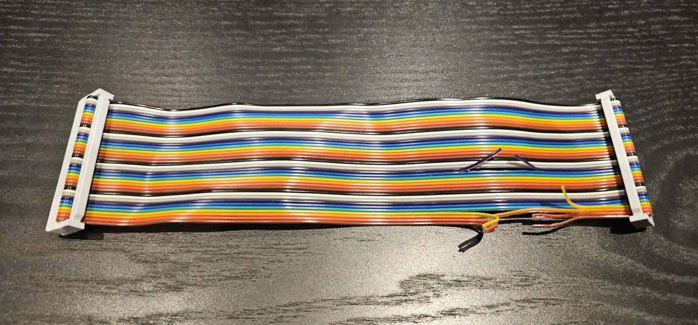
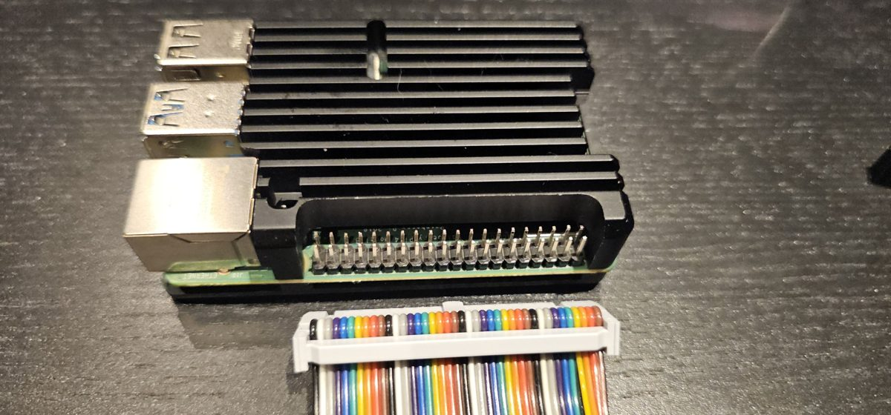
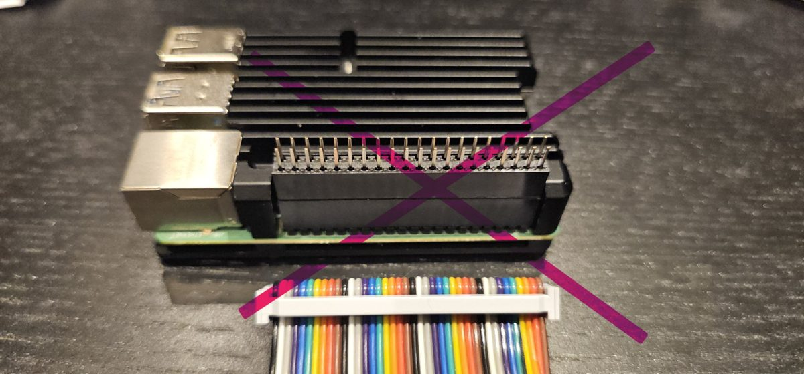

# Golem quick start

*From the box to the first sound in about 20 minutes. The full guide is
[guide.md](guide.md). Versión en español: [inicio-rapido.md](inicio-rapido.md).*

The Golem is a Raspberry Pi that plays the ZX Spectrum Next's MIDI music: an
MT-32, a General MIDI synth (FluidSynth) and a Sound Blaster's FM chip (OPL3).
The Next sends it MIDI through a cable and gets the sound back through the
same cable, so it comes out of the Next's HDMI as usual.

> **A test setup, at your own risk.** The Golem is in development and this
> setup is for testing. The cable goes on a header inside the Next, so the
> Next has to be open: ideally a bare board or a test machine, such as an
> N-Go, not the Next you care most about. Follow the steps with care. You use
> it entirely at your own risk: the software and these instructions come with
> no warranty, and the authors are not responsible for any damage.

## What you need

- A ZX Spectrum Next with NextZXOS.
- A Raspberry Pi 4 (1 GB is enough) or Pi 3, **bare, without a case** (see
  Part 1, step 4), with **its own power supply** (for a Pi 4, the official
  5.1 V 3 A USB-C one). The Next does not power it.
- A microSD card for the Pi (any size, FAT32).
- A **40-way ribbon cable**, female IDC connector at both ends (2×20, 2.54 mm),
  as short as practical, and small side cutters.
- Optional: the MT-32 or CM-32L ROMs, for MT-32 sound. They are not
  included: you supply them. Without them, FluidSynth (General MIDI, with a
  free SoundFont, see Part 2) and OPL3 work anyway.

## Part 1. Hardware: the cable

For now the link is a plain ribbon cable with four wires cut. A proper
adapter is being designed.

> **Everything switched off and unplugged while you work.** Never connect or
> disconnect the cable with the Next or the Pi powered.

1. **Find wire 1.** It is at one edge of the ribbon: on a grey ribbon, the
   one with the coloured stripe; on a rainbow ribbon, the brown one at the
   edge (the colours repeat brown, red, orange, yellow, green, blue, violet,
   grey, white, black). The connectors also mark pin 1 with a small
   triangle. The wires are numbered in order across the ribbon: wire *n* goes
   to pin *n* at both ends.
2. **Cut wires 1, 2, 4 and 17** (3.3 V and 5 V; on a rainbow ribbon:
   brown, red, yellow, and the violet of the second group), close to one of
   the connectors. The Next and the Pi have separate supplies: these lines must
   not join them. Only ground is shared. Bend the cut ends apart, or cover
   them with tape, so they cannot touch. If you have a multimeter, check that
   pins 1, 2, 4 and 17 no longer connect end to end.

   

3. **On the Next:** the cable goes on the **Accelerator** header, the
   2×20 header where a Raspberry Pi Zero would sit (not J15). Remove the Pi
   Zero if one is fitted. Wire 1 of the cable on pin 1 of the header.

4. **On the Pi:** the other end on the Pi's 40-pin GPIO header, wire 1 on
   pin 1. Pin 1 is at the end of the header away from the USB ports.

   **Use a bare Pi.** Many cases, like the heatsink case in the picture,
   leave the pins too short or too boxed in for the ribbon's connector, and
   it does not fit. A riser (a header extender) would make it fit, but we do
   not recommend it: it is fragile, and its long pins bend easily. For
   testing, take the Pi out of its case.

   

   

5. Check both ends once more: wire 1 on pin 1 at both, no pin left out.

## Part 2. Software

### The Pi's card

1. Download the latest Golem firmware, `mt32-pi-golem-x.y.z.zip`:
   <https://github.com/malandante/mt32-pi/releases/latest>.
2. Unzip it onto an empty microSD card formatted FAT32, at its root. That is
   all: the card is not flashed, so no Raspberry Pi Imager, balenaEtcher or
   image file is needed.
3. Optional: copy the MT-32 or CM-32L ROMs to `roms/`. Each synth needs two:
   the **control ROM** (its program) and the **PCM ROM** (its sampled
   sounds). File names do not matter. The sizes of complete ROMs:

   | ROM | Size |
   | --- | --- |
   | MT-32 control, versions 1.xx («old») | 64 KB |
   | MT-32 control, versions 2.xx («new») | 128 KB |
   | CM-32L control | 64 KB |
   | MT-32 PCM | 512 KB |
   | CM-32L PCM | 1 MB |

   Two things to watch:

   - **Complete ROMs only.** On the real synth some ROMs are spread over two
     chips, and many collections also keep them as two half files, named
     for example `…_a` and `…_b`, or `…_h` and `…_l`, each half the size in
     the table. The Golem does not take halves: copy only the complete file.
   - **One control ROM per set.** The Golem has three sets: MT-32 «old»,
     MT-32 «new» and CM-32L. Copy at most one control ROM of each (for
     example `mt32_ctrl_1_07.rom`, `mt32_ctrl_2_07.rom` and
     `cm32l_ctrl_1_02.rom`), with the PCM ROMs. With several of the same set
     it may pick one you did not want. Do not copy a whole ROM collection.

   Other SoundFonts go in `soundfonts/`.
4. Open `mt32-pi.cfg` on the card with a text editor, find the line
   `output_device = pwm` and change it to `output_device = i2s`. Without it
   the Pi sends its sound to its own headphone jack instead of to the Next.
5. For General MIDI (FluidSynth), download the free GeneralUser GS SoundFont
   from <https://www.schristiancollins.com/generaluser.php> and copy its
   `.sf2` file to `soundfonts/`.
6. Put the card in the Pi.

The next firmware version will come with steps 4 and 5 already done.

Without MT-32 ROMs the Golem starts with FluidSynth; without a SoundFont too,
with OPL3. Nothing to change: `.golem status` shows which engine is active.

### The Next's card

1. Download the latest golem-next, `golem-next-x.y.z.zip`:
   <https://github.com/malandante/golem-next/releases/latest>.
2. Copy its folders `nextzxos`, `dot`, `docs` and `midi` to the root of the
   Next's card, merging them with the folders already there.
3. Install the driver every time the Next starts: load the start-up program
   (`LOAD "c:/nextzxos/autoexec.bas"`, or start a new one if there is none),
   add these lines and save it with `SAVE "c:/nextzxos/autoexec.bas"`:

   ```
   10 .install "c:/nextzxos/GOLEM.DRV"
   20 .golem output golem
   ```

   The second line switches on the Next's sound link with the Pi (its I²S
   port) from the start: the Pi's sound comes into the Next through the
   Golem cable. After switching on, the Next keeps that link off until a
   `.golem` command uses it, so without this line a MIDI keyboard plugged
   into the Pi stays silent until then.

### First sound

1. Switch on the Pi, then the Next. Give the Pi about 10 seconds.
2. On the Next:

   ```
   .golem status
   ```

   It answers with a line starting `Golem: engine`. If it says
   "no answer", see below.
3. A test note (note 60, velocity 100, 2 seconds) on the engine that is
   always there, OPL3, and on General MIDI (FluidSynth, if you copied the
   SoundFont):

   ```
   .opl3 note 60 100 2
   .gm note 60 100 2
   ```

   If you put the MT-32 ROMs on the Pi's card, try that engine too:

   ```
   .mt32 note 60 100 2
   ```

   Without ROMs it answers with an error: the MT-32 is not available, and
   the rest works the same.
4. Play a MIDI file of yours, choosing the engine: `.mt32 play song.mid` for
   MT-32 music (most PC games of 1988-1992), `.gm play song.mid` or
   `.opl3 play song.mid` for General MIDI. SPACE stops it.
5. Help on the Next: `.guide golem`.

## If it does not work

**"Golem: GOLEM.DRV missing or incompat."** The driver is not installed, so
the commands cannot talk to the Pi. Run `.install "c:/nextzxos/GOLEM.DRV"`
by hand, and check that the line is in your autoexec, so it is installed at
every start-up.

**`.golem status` says "no answer".** The Next sent its question and nothing
came back. In order:

- The Pi is switched on and has had about 10 seconds to start.
- Its card has the Golem firmware (`mt32-pi-golem-…`), not the original
  mt32-pi, which does not answer.
- The cable: wire 1 on pin 1 at both ends, and the connectors fully
  pushed in. A cable on backwards or one row out connects the wrong pins.

**The Pi's red LED blinks.** Its power supply is too weak and the Pi resets
or misses MIDI. Use the official one.

**`.golem status` answers, but nothing sounds.** The Pi gets the MIDI but its
sound does not reach you:

- The Pi must send its sound to the Next. In `mt32-pi.cfg`, section
  `[audio]`, the line must be `output_device = i2s` (step 4 of «The Pi's
  card»). With `pwm` or `hdmi` the sound goes to the Pi's own outputs.
- The autoexec line `.golem output golem` (or any `.golem` command) has run,
  so the Next takes the Pi's sound.
- The volume of the TV or amplifier on the Next's HDMI, and the Golem's own
  volume: `.golem set volume 100`.

**`.mt32` does not sound, `.gm` and `.opl3` do.** The MT-32 did not start:
its ROMs are missing from `roms/` on the Pi's card, one of the two (control
or PCM) is missing, or they are half files (`_a`/`_b`, `_h`/`_l`) instead of
complete ROMs. See step 3 of «The Pi's card».

**`.gm` does not sound.** There is no SoundFont in `soundfonts/` on the Pi's
card: see step 5 of «The Pi's card».

## Next steps

- `.golem set loud on` makes the Golem louder against the Next's own sound.
- The full guide: [guide.md](guide.md).
